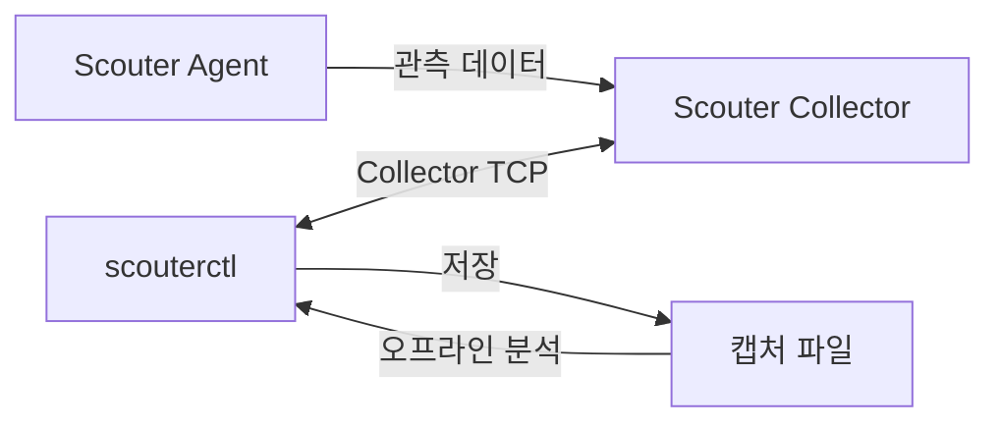

# scouterctl

[English](README.md) | 한국어

터미널과 자동화 작업에서 [Scouter](https://github.com/scouter-project/scouter)를 운영하기 위한 CLI입니다.

현재 진단과 데이터 추출을 제공하며, 설정 변경과 Agent 제어까지 다루는 것을 목표로 합니다.

## 주요 기능

- Collector·Agent의 상태, 설정, 실시간 지표와 트랜잭션·SQL·오류 프로파일 조회
- 중단 후 이어서 받을 수 있는 캡처 파일 저장
- 저장한 캡처의 검색·서비스별 요약·비교
- 스크립트와 다른 도구에서 사용할 수 있는 JSON·JSONL 출력

## 시작하기

[릴리스](https://github.com/oxspan/scouterctl/releases)에서 Linux x64 또는 Windows x64 ZIP을 받아 [설치 안내](docs/ko/installation.md)에 따라 설치합니다.

JDK 21이 필요합니다. Collector의 버전은 [지원 버전 목록(영문)](docs/supported-versions.md)을 확인하세요.

```sh
scouterctl doctor --host 127.0.0.1 --port 6100 --user guest --interactive
```

이어서 [빠른 시작](QUICKSTART.ko.md)을 따라 연결·조회·추출을 실행할 수 있습니다.

## 동작 방식



## 문서

- [문서 목록](docs/ko/README.md)
- [빠른 시작](QUICKSTART.ko.md) · [설치](docs/ko/installation.md) · [연결과 비밀번호](docs/ko/connections.md)
- [구조와 구성 요소(영문)](docs/architecture.md)
- [출력 형식과 종료 코드(영문)](docs/cli-contract.md) · [지원하는 캡처 파일 버전(영문)](docs/capture-compatibility.md)
- [기여 안내](CONTRIBUTING.ko.md) · [변경 기록(영문)](CHANGELOG.md)
- [보안 안내](SECURITY.ko.md) · [Apache License 2.0](LICENSE) · [외부 라이브러리 출처(영문)](vendor/README.md)
