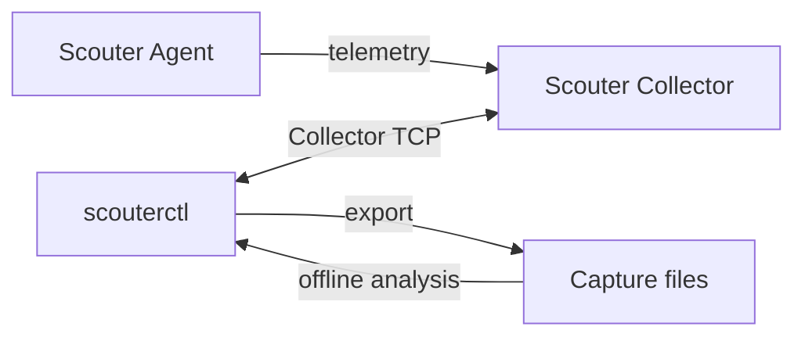

# scouterctl

A CLI for operating [Scouter](https://github.com/scouter-project/scouter) from your terminal and automation workflows.

Starting with diagnostics and data capture, the project aims to cover configuration management and Agent operations.

## Features

- Inspect Collector and Agent status, settings and real-time metrics; query transactions, SQL and errors.
- Export resumable captures for offline investigation.
- Search, summarize and compare saved captures.
- Use JSON/JSONL output in scripts and other tools.

## Quick start

Install the Linux x64 or Windows x64 command package from [Releases](https://github.com/oxspan/scouterctl/releases) (1.0.0 and later), following the [installation guide](docs/installation.md).

Requires JDK 21. See [supported Collector versions](docs/supported-versions.md).

```sh
scouterctl doctor --host 127.0.0.1 --port 6100 --user guest --interactive
```

Continue with [usage and examples](QUICKSTART.md). Published 0.x JAR packages use the [legacy instructions](docs/legacy-jar.md).

## How it works



## Documentation

- [Usage and examples](QUICKSTART.md) · [Command installation](docs/installation.md)
- [Architecture](docs/architecture.md)
- [JSON output and exit codes](docs/cli-contract.md) · [Capture compatibility](docs/capture-compatibility.md)
- [Contributing](CONTRIBUTING.md) · [Changelog](CHANGELOG.md)
- [Security](SECURITY.md) · [Apache License 2.0](LICENSE) · [Third-party provenance](vendor/README.md)
