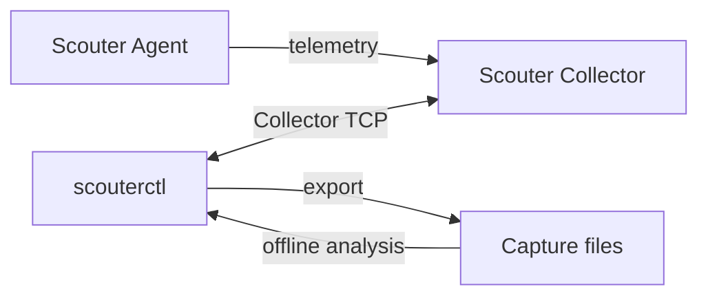

# scouterctl

A CLI for operating [Scouter](https://github.com/scouter-project/scouter) from your terminal and automation workflows.

Starting with diagnostics and data capture, the project aims to cover configuration management and Agent operations.

## Features

- Discover applications and query transactions, SQL and errors.
- Export resumable captures for offline investigation.
- Search, summarize and compare saved captures.
- Use JSON/JSONL output in scripts and other tools.

## Quick start

Download a ZIP and its `SHA256SUMS` from [Releases](https://github.com/oxspan/scouterctl/releases), then follow the [installation guide](QUICKSTART.md#prerequisites).

Requires JDK 21. See [supported Collector versions](docs/supported-versions.md) for online commands.

From the extracted directory, check your Collector connection (Bash):

```bash
SCOUTERCTL_JAR="scouterctl-$(cat version.txt)-all.jar"
java -jar "$SCOUTERCTL_JAR" doctor \
  --host 127.0.0.1 --port 6100 --user guest --interactive
```

Replace the connection values with your own; the command prompts for your password. Continue with [connection setup and transaction queries](QUICKSTART.md#connect-and-find-a-target).

## How it works



## Documentation

- [Usage and examples](QUICKSTART.md)
- [Architecture](docs/architecture.md)
- [JSON output and exit codes](docs/cli-contract.md) · [Capture compatibility](docs/capture-compatibility.md)
- [Contributing](CONTRIBUTING.md) · [Changelog](CHANGELOG.md)
- [Security](SECURITY.md) · [Apache License 2.0](LICENSE) · [Third-party provenance](vendor/README.md)
