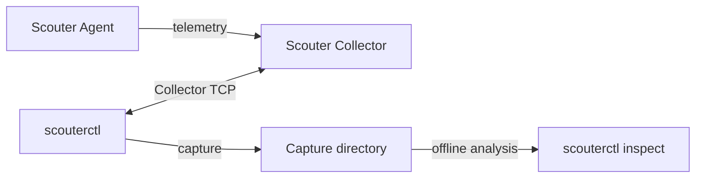

# scouterctl

A command-line client for [Scouter](https://github.com/scouter-project/scouter). Query transactions and profiles directly from a Collector, export captures, and investigate them offline with JSON/JSONL output.

scouterctl is an early-stage, read-only tool. Commands and output formats may change before 1.0.

## Features

- Discover monitored applications and search their transactions.
- Inspect profiles, SQL statements, and application or SQL errors.
- Capture transactions and profiles for offline investigation; resume interrupted captures.
- Find slow or failed requests and summarize errors and latency by service.
- Compare service counts, error ratios, and request durations between saved captures.
- Save named Collector connections without storing passwords or sessions.
- Use UTF-8 JSON/JSONL output in scripts and other tools.

## How it fits together



The Agent instruments the application; the Collector receives and stores its telemetry. scouterctl queries the Collector and exports captures. Offline inspection, summaries, and comparisons read those files without connecting to the Collector.

See [Architecture](docs/architecture.md) for the application components and capture format.

## Requirements

- JDK 21.
- Scouter Collector **2.21.3**, a query account, and TCP access for online commands.
- An existing capture for offline inspection; no Collector connection is needed.

Install the Collector and Agent separately. Collector connections do not provide built-in TLS; use a trusted network or a tunnel. On Windows, use ASCII installation paths and command-line arguments.

## Get started

Download a ZIP and its `SHA256SUMS` from [Releases](https://github.com/oxspan/scouterctl/releases). Follow the [installation instructions](QUICKSTART.md#prerequisites) for Linux, macOS, or PowerShell.

From the extracted directory, connect to your Collector. This example uses Bash; replace the host, port, and account with your own values.

```bash
SCOUTERCTL_JAR="scouterctl-$(cat version.txt)-all.jar"
SCOUTERCTL=(java -jar "$SCOUTERCTL_JAR" --host 127.0.0.1 --port 6100 --user guest)
read -r -s -p 'Collector password: ' SCOUTERCTL_PASSWORD
printf '\n'
export SCOUTERCTL_PASSWORD

"${SCOUTERCTL[@]}" doctor
"${SCOUTERCTL[@]}" object list

unset SCOUTERCTL_PASSWORD
```

Continue with [transaction queries and captures](QUICKSTART.md#query-and-export), or set up a [saved connection](QUICKSTART.md#saved-connections-and-terminal-input).

## Inspect a capture

Use a capture created with `capture --include-profiles`:

```bash
java -jar "$SCOUTERCTL_JAR" inspect search --directory ./capture --errors-only
java -jar "$SCOUTERCTL_JAR" inspect summary --directory ./capture --sort elapsed
java -jar "$SCOUTERCTL_JAR" inspect --directory ./capture --txid '<TXID>'
java -jar "$SCOUTERCTL_JAR" inspect compare --before ./before --after ./after
```

Use a transaction ID returned by the search to open its profile. Add `--include-text` to include stored service names, SQL statements, and error messages when the capture contains them. This text may contain sensitive application data.

Summaries describe captured XLogs, which can include separate error dispatches; they are not a count of incoming HTTP requests or a measure of complete traffic.

## Build from source

With `JAVA_HOME` pointing to JDK 21:

```bash
./gradlew test fatJar
```

The executable JAR is written to `build/libs/`. On Windows, use `gradlew.bat`.

## Documentation

- [Quick start and command usage](QUICKSTART.md)
- [Architecture](docs/architecture.md)
- [Changelog](CHANGELOG.md)
- [Contributing](CONTRIBUTING.md)
- [Scouter library provenance and license](vendor/README.md)
