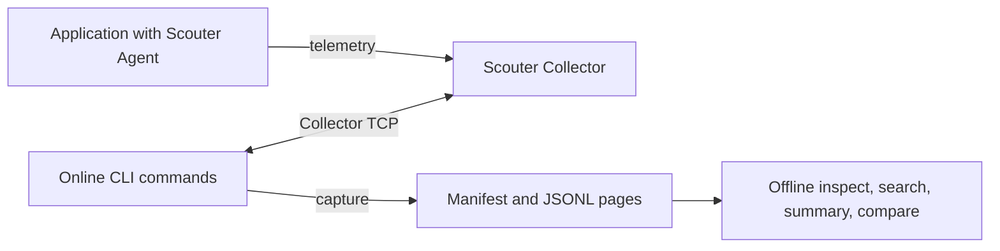

# Architecture

scouterctl is a Kotlin/JVM command-line application packaged as a single executable JAR. It runs with JDK 21. Scouter Collector and Agent are separate processes, installed and operated independently.

## Data flow

Online commands authenticate to the Collector and issue read requests. `capture` writes local files; offline commands read captures without authentication or a Collector connection. The client supports Collector 2.21.3 and rejects other online versions. The Collector TCP transport has no built-in TLS; use a trusted network or a tunnel.

## Application components

The project has one Gradle application module. The following files group its current responsibilities:

| Component | Responsibility |
| --- | --- |
| [Main.kt](../src/main/kotlin/dev/scouterctl/Main.kt) | picocli argument parsing, command dispatch, JSON/JSONL output and exit codes |
| [ConnectionOptions.kt](../src/main/kotlin/dev/scouterctl/ConnectionOptions.kt), [ContextStore.kt](../src/main/kotlin/dev/scouterctl/ContextStore.kt) | Endpoint selection, explicit hidden password input, local named connections |
| [CollectorSource.kt](../src/main/kotlin/dev/scouterctl/CollectorSource.kt) | `ObservationSource` implementation using Collector TCP and the pinned Scouter binary codec |
| [Capture.kt](../src/main/kotlin/dev/scouterctl/Capture.kt), [EvidenceCapture.kt](../src/main/kotlin/dev/scouterctl/EvidenceCapture.kt) | Paged transaction export, profile capture, checkpoints and resume |
| [EvidenceStore.kt](../src/main/kotlin/dev/scouterctl/EvidenceStore.kt), [EvidenceModel.kt](../src/main/kotlin/dev/scouterctl/EvidenceModel.kt) | V2 manifests/pages, checksums and record integrity validation |
| [Inspect.kt](../src/main/kotlin/dev/scouterctl/Inspect.kt), [EvidenceSearch.kt](../src/main/kotlin/dev/scouterctl/EvidenceSearch.kt) | Offline profile lookup and filtered transaction search |
| [ServiceSummary.kt](../src/main/kotlin/dev/scouterctl/ServiceSummary.kt), [CaptureComparison.kt](../src/main/kotlin/dev/scouterctl/CaptureComparison.kt) | Service-level captured metrics and comparison of two captures |

picocli handles command-line parsing; kotlinx.serialization handles JSON. The vendored `scouter-common` library supplies the wire formats. See its [provenance and license](../vendor/README.md). Tests use Kotest; native terminal support is a test dependency and is not part of the distributed application.

## Local data

Named connections store host, port and account plus the selected context. They do not store passwords, password hashes or sessions. An online invocation obtains its password from `SCOUTERCTL_PASSWORD` or explicit terminal input and disconnects after the operation.

A profile capture uses `scouterctl.capture/v2`: a manifest records the source, query, cursor, completion and page checksums; JSONL pages contain XLogs, profile availability and profiles. Dictionary text is optional and may contain sensitive application data. Offline analysis accepts v2; it does not silently migrate transaction-only v1 captures.

Checksums detect changed page contents, not authenticity. The manifest is unsigned. Capture completion describes the extraction, not total traffic coverage: sampling and upstream coverage remain explicit metadata. Service statistics and comparisons use captured XLogs rather than incoming HTTP request counts. Known service-name conflicts are reported, but numeric service hashes cannot distinguish every collision.

See [Quick start](../QUICKSTART.md) for commands, limits and exit codes, and [Contributing](../CONTRIBUTING.md) for build and release procedures.
