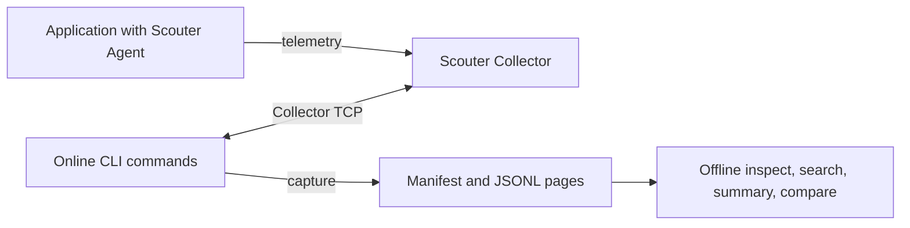

# Architecture

scouterctl is a Kotlin/JVM command-line application distributed as Linux and Windows command packages. It runs with JDK 21. Scouter Collector and Agent are separate processes, installed and operated independently.

## Data flow



Online commands authenticate to the Collector and issue read requests. `capture` writes local files; offline commands read captures without authentication or a Collector connection. The client accepts the [tested Collector releases](supported-versions.md) and rejects unverified online versions. The Collector TCP transport has no built-in TLS; use a trusted network or a tunnel.

## Dependency boundaries

The project uses one Gradle module with the `dev.scouterctl.MainKt` entrypoint. Dependencies point inward; [Bootstrap.kt](https://github.com/oxspan/scouterctl/blob/master/src/main/kotlin/dev/scouterctl/bootstrap/Bootstrap.kt) constructs the concrete objects.

| Package | Responsibility | Project dependencies |
| --- | --- | --- |
| [core](https://github.com/oxspan/scouterctl/tree/master/src/main/kotlin/dev/scouterctl/core) | Plain observations, evidence, connection invariants and named failures | None |
| [application](https://github.com/oxspan/scouterctl/tree/master/src/main/kotlin/dev/scouterctl/application) | Capture/resume, streaming, context selection and offline analysis | core |
| [adapters.collector](https://github.com/oxspan/scouterctl/tree/master/src/main/kotlin/dev/scouterctl/adapters/collector) | Typed read requests, socket lifecycle and pinned Scouter codec | application, core |
| [adapters.files](https://github.com/oxspan/scouterctl/tree/master/src/main/kotlin/dev/scouterctl/adapters/files) | Directory-bound repositories, integrity checks, atomic writes and context lock | application, core, serialization |
| [adapters.serialization](https://github.com/oxspan/scouterctl/tree/master/src/main/kotlin/dev/scouterctl/adapters/serialization) | Explicit wire DTOs and feature-grouped mappings | core |
| [cli](https://github.com/oxspan/scouterctl/tree/master/src/main/kotlin/dev/scouterctl/cli) | picocli options, typed invocation interpretation, family handlers and UTF-8 presentation | application, core, serialization |
| [bootstrap](https://github.com/oxspan/scouterctl/tree/master/src/main/kotlin/dev/scouterctl/bootstrap) | Environment config paths, version resource and concrete construction | All outer components |

Core and application use Kotlin/JDK value, time and collection utilities. They do not use filesystem/network APIs, process access, reflection-based lookup, Scouter classes, picocli or serialization. CLI handlers receive port factories; local and offline dispatch never resolves online credentials or connections. `Main.kt` delegates entry only. The flat command words and picocli option facade preserve command parsing and help layout.

[Ports.kt](https://github.com/oxspan/scouterctl/blob/master/src/main/kotlin/dev/scouterctl/application/Ports.kt) declares `ObservationSource`, `CaptureRepository` (v1), `EvidenceRepository` (v2/v3), `CounterCaptureRepository` and `ContextRepository`. Repositories are bound to directories externally, so use cases receive records and manifests rather than paths or JSON. `ContextRepository.update` executes its read/modify/write callback while the file adapter holds the lock. An online handler owns the source's `use` lifetime, including when a streaming output callback fails.

Capture writes each page before publishing its manifest checkpoint. Resume validates the stored source/query/text policy and all referenced pages before updating anything. Offline traversal continues through every page even after a search limit is filled. Search keeps a bounded priority queue; summary and comparison retain the existing service limits and full integrity checks. Atomic moves, profile-capture no-follow file access and per-page size limits remain in the file adapters.

## Wire formats and failures

Inner models have no serialization annotations. The serialization adapter owns `Json { encodeDefaults = true }`, explicit `Dto` classes and bidirectional mappings. Stored records and CLI output share those DTOs. Field order, nulls, enum wire labels and string transaction IDs remain compatible with existing captures. No format migration occurs.

`OperationFailure` carries a named core error without a CLI exit number. Adapters translate expected I/O failures: EOF remains `IO_ERROR`, while socket errors and timeouts remain `CONNECTION_FAILED`. `UnexpectedFailure` distinguishes translated argument/decoding exceptions from expected operation failures. The capture use case records only the failure categories that previously wrote a checkpoint; unexpected decoding does not overwrite the last committed manifest. CLI presentation owns exit mapping and the final unexpected-exception fallback.

picocli handles parsing; kotlinx.serialization handles boundary JSON. The vendored `scouter-common` library supplies the wire formats; see its [provenance and license](../vendor/README.md). Construction is explicit rather than managed by a DI framework. PTY support is test-only; the Windows JNI launcher hosts the same JVM application.

## Dependency checks

[ArchitectureTest](https://github.com/oxspan/scouterctl/blob/master/src/test/kotlin/dev/scouterctl/ArchitectureTest.kt) runs JDK `jdeps` against compiled production classes, including generated code. It enforces inward dependencies and checks negative fixtures for forbidden I/O, adapter, serialization, process and reflection dependencies.

```sh
./gradlew test --tests '*ArchitectureTest'
```

See [testing](testing.md) for the full suite and opt-in Collector/Agent checks.

## Local data

Named connections store host, port and account plus the selected context. They do not store passwords, password hashes or sessions. An online invocation obtains its password from `SCOUTERCTL_PASSWORD` or explicit terminal input and disconnects after the operation.

A profile capture uses `scouterctl.capture/v3`: a manifest records the source, query, cursor, completion and page checksums; JSONL pages contain XLogs, profile availability and profiles. Dictionary text is optional and may contain sensitive application data. Offline analysis accepts existing v2 and new v3; it does not silently migrate transaction-only v1 captures. The current writer resumes v3 only. See [Capture compatibility](capture-compatibility.md) for the format policy.

Checksums detect changed page contents, not authenticity. The manifest is unsigned. Capture completion describes the extraction, not total traffic coverage: sampling and upstream coverage remain explicit metadata. Service statistics and comparisons use captured XLogs rather than incoming HTTP request counts. Known service-name conflicts are reported, but numeric service hashes cannot distinguish every collision.

See the [command guides](README.md#using-scouterctl) for command details and [output reference](cli-contract.md) for exit codes, and [Contributing](../CONTRIBUTING.md) for build and release procedures.

Counter history has separate pure query/window models and `scouterctl.counter-stream/v1` JSONL events. Multi-day `counter export` stores `scouterctl.counter-capture/v1` manifests and point files through its own repository port. The application writes each chunk before checkpointing; the file adapter owns atomic replacement, validation and the writer lock. These formats do not alter XLog captures. See [counter export](counter-export.md).
